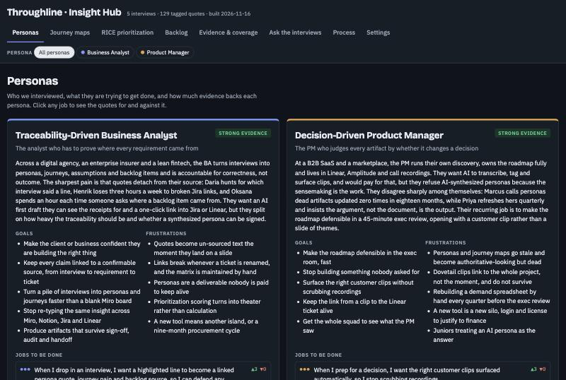

# Insight Hub

Turn a folder of customer-interview transcripts into a living product-research board — **personas**, **journey maps**, a **RICE-ranked feature list**, a **delivery backlog** and an **ask-the-interviews** panel — with every statement linked back to the exact quotes for and against it.

Claude does the reading: it proposes a frame (personas + journey stages), tags every quote in each transcript, then synthesizes personas, journeys and scored features. You review and edit everything. The app runs **entirely on your own computer** — your transcripts and results never leave it, except the text sent to Claude for processing.

> Built for the **"AI for Product Managers"** course. Fork it, run it locally, extend it.
>
> The bundled sample is deliberately meta: five fictional interviews with **Business Analysts and Product Managers** about the tools they use to build personas, journey maps, hypotheses and roadmaps — the very work this app does. Load the demo to see the board analyze them.



---

## What it does

| Tab | What you get |
|---|---|
| **Personas** | Each persona with its tagline, goals, frustrations and jobs-to-be-done. Evidence level (strong / moderate / thin) is honest about how many people back it. |
| **Journey maps** | One map per persona: each stage shows pains, jobs, existing tools & workarounds, how the step works with your product today, and features to build. An emotion curve runs across the top. |
| **RICE prioritization** | Every feature scored **Reach × Impact × Confidence ÷ Effort**. Reach starts from the number of interviewees who back it; confidence from how strong their evidence is. Editable, filterable, sortable. |
| **Backlog** | Features you send from the RICE list, moved through delivery with owner, target release and a ticket link. |
| **Evidence & coverage** | A heatmap of where the evidence is thick and where you're guessing, your hypotheses scored for/against, and the full source list. |
| **Ask the interviews** | Claude answers questions **only** from the tagged quotes, with citations you can open — and tells you when the interviews don't cover something instead of guessing. |

Open any statement, job, feature or hypothesis to read the verbatim quotes **for** and **against** it.

---

## Requirements

- **Node.js 20 or newer** ([nodejs.org](https://nodejs.org))
- A way for the app to reach Claude — **one** of:
  - an **Anthropic API key** ([console.anthropic.com](https://console.anthropic.com)), or
  - **Claude Code** installed and logged in on your computer ([claude.com/claude-code](https://claude.com/claude-code))

---

## Run it locally

```bash
git clone https://github.com/ioannWILL/ai-for-pm-insight-hub.git
cd ai-for-pm-insight-hub
npm install
npm start
```

Then open **http://localhost:4317** and follow the two-minute setup:

1. **Transcripts folder** — a folder of `.md`, `.txt`, `.vtt` or `.srt` files, one interview per file (any language). No transcripts of your own yet? Use the **sample interviews** that ship with the app.
2. **Output folder** — an empty folder where results are written, as plain JSON you can read and version.
3. **Claude** — paste an API key, or switch to Claude Code. Test the connection.
4. **Product** — optionally name what the interviews are about, to help Claude pick sensible personas.

Then open **Process** and run it. Prefer to look around first without spending any credits? On the Process tab, **Load demo results** fills the board from the bundled sample interviews.

---

## How it works

```
transcripts/*.md ─▶ 1. taxonomy ─▶ 2. tag quotes ─▶ 3. synthesize ─▶ kb.json ─▶ the board
                     (personas,       (one JSON          (one JSON per
                      stages)          per interview)     persona)
```

Everything is written to your output folder as JSON, so you can inspect every step:

| File | What |
|---|---|
| `taxonomy.json` | Personas, journey stages, products and hypotheses. Edit it on the Process tab. |
| `extracts/<source>.json` | The tagged quotes from one transcript. |
| `nuggets.json` | All quotes merged. |
| `synth/<persona>.json` | Persona, journey, opportunities and features. |
| `kb.json` | Everything the board shows. |
| `state.json` | **Your** edits to scores and the backlog. A rebuild never overwrites it. |

Add a new interview to the folder and run **Process new transcripts**: only the new file is read, and it updates the existing personas without discarding your score edits.

The three prompts that do the work are plain, readable templates in [`server/lib/prompts.js`](server/lib/prompts.js) — they *are* the method. Read them.

---

## Project layout

```
server/            local HTTP server + the pipeline
  index.js         routes; serves the app on 127.0.0.1 only
  lib/             config, file access, Claude calls, prompts, pipeline, state, ask
public/            the single-page app (plain JS, no build step)
scripts/           environment check run before start
samples/
  transcripts/     five fictional interviews (3 BAs, 2 PMs) about product-discovery tooling
  demo-output/     a pre-built knowledge base for those interviews
```

## Your data & privacy

The server binds to `127.0.0.1` and refuses requests not addressed to `localhost`. Your API key is stored only on your machine, in `.insight-hub/config.json` (git-ignored), readable by your user. The only data that leaves your computer is the transcript text sent to Claude to process it.

## License

MIT — see [LICENSE](LICENSE).
